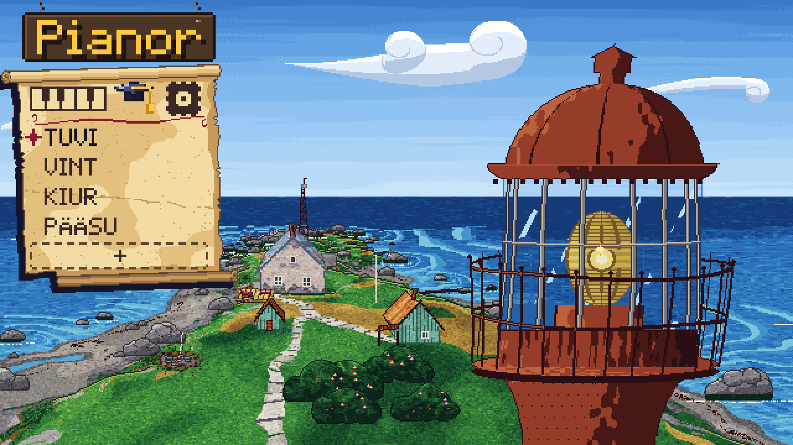
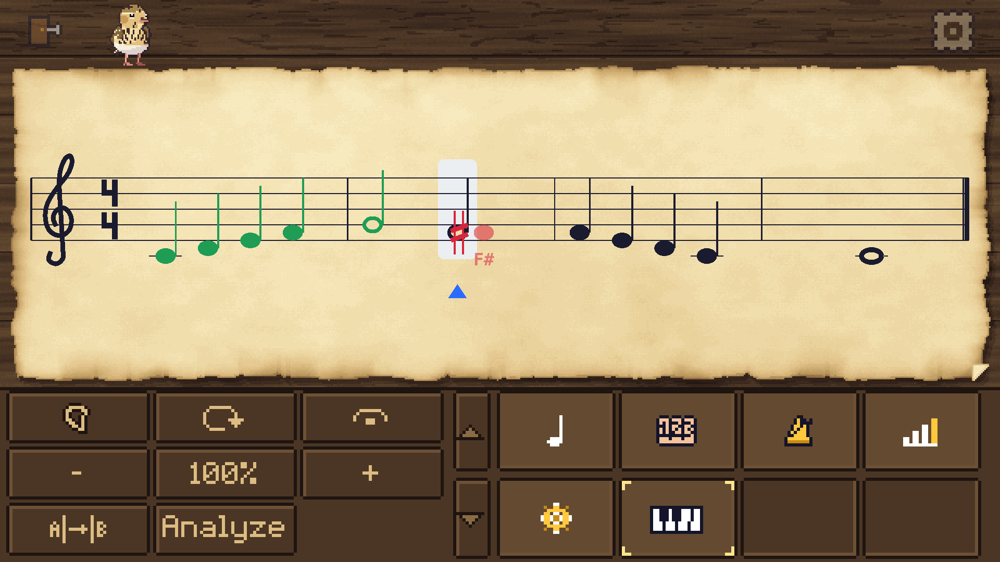
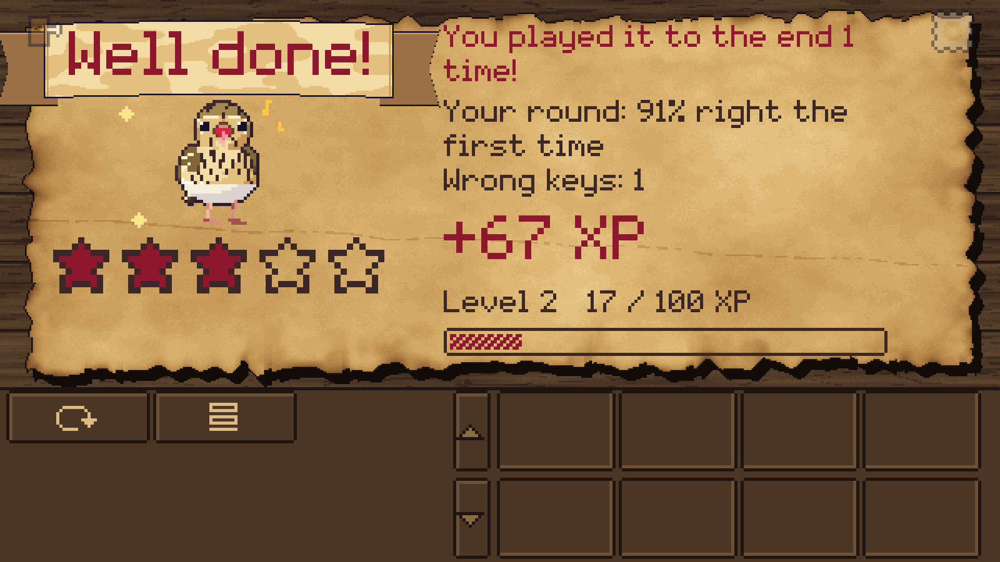
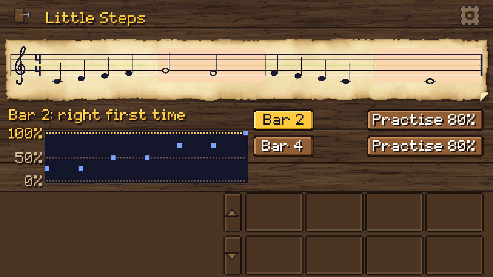
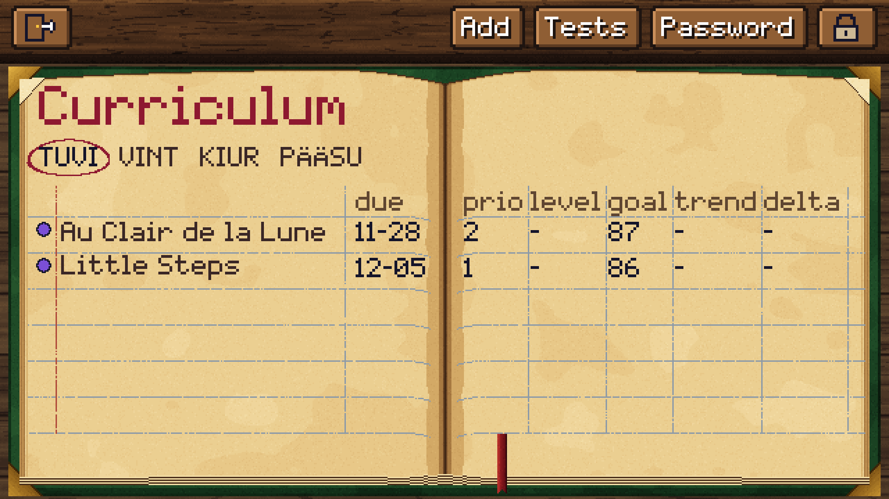
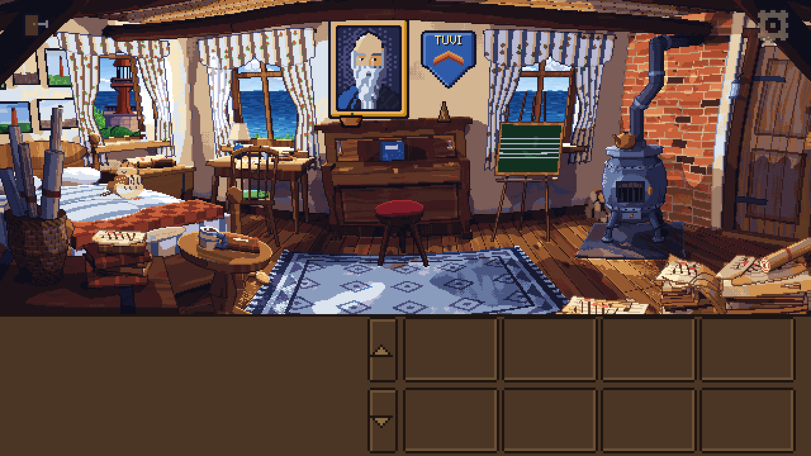
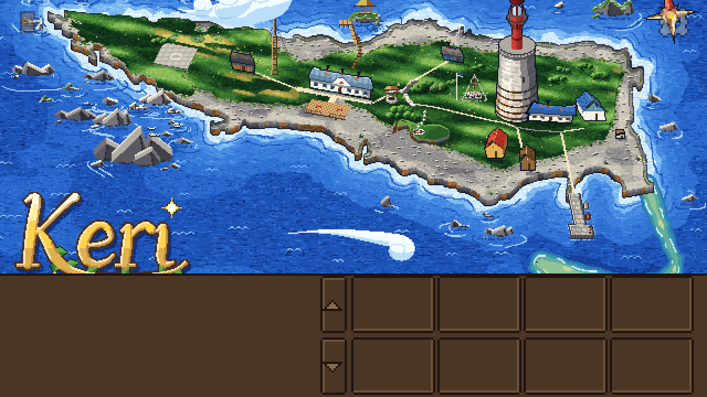
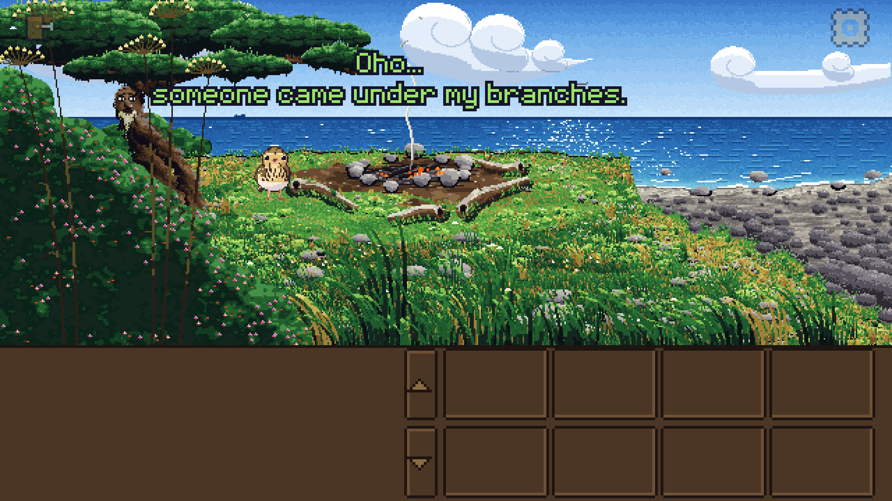
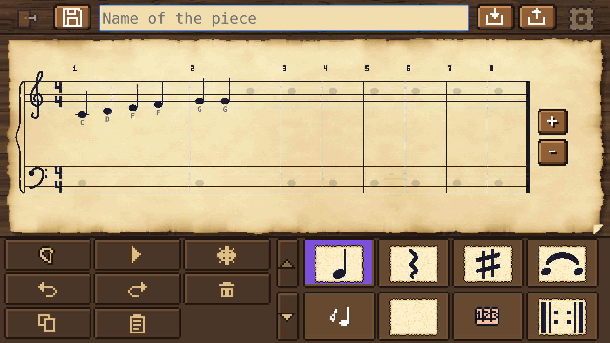

# Pianor

**Learn to read music and play the piano, one game at a time.** Pianor is a piano-learning game for beginners, children and adults alike. You plug a USB-MIDI keyboard into your computer, read real staff notation on the screen and play it on real keys. Around the lessons is a small point-and-click adventure on Keri, an island off the north coast of Estonia, drawn in the pixel-art manner of the early 1990s adventure games.



## How Pianor teaches

Pianor is built on one rule: every part of the game has to make the student read and play more, or better. The game is there to bring the student back to the piano, not to replace practice.

- **You read real notes.** The staff is the main view, with big, clear notes.
- **The music waits for you.** In Wait mode the cursor waits on each note until you press the right key, so a beginner is never rushed. Tempo mode, where the music keeps the beat, comes when you are ready.
- **Mistakes tell you something.** A wrong key shows on the staff by name, beside the note you should have played, and the game tells apart the right letter in the wrong octave, a neighbouring key and another letter.
- **Honest feedback.** The game says what happened ("91% right the first time", "wrong keys: 1"), never empty praise and never shaming. Stars, XP and levels all come from what you actually played.
- **Repetition, without punishment.** Rewards ask for many clean repetitions. A lost round still earns XP, and nothing you earned is ever taken away.
- **Learn a piece in small steps.** A new piece can be learned bar by bar: one bar, then two, then four, each played perfectly once before the next appears.

<table>
<tr>
<td></td>
<td></td>
</tr>
<tr>
<td><em>Practice: notes played right turn green; a wrong key shows by name beside the note you should play.</em></td>
<td><em>After a piece: stars, notes right the first time, wrong keys and XP.</em></td>
</tr>
</table>

## What you can do

### Play and practise pieces

- **A growing library** of original and public-domain pieces (folk songs, classics such as Ode to Joy, and short exercises), ordered in levels from the right hand in C position upwards.
- **One or two hands.** Two-hand pieces are drawn on a grand staff, and playing both hands together earns a bonus.
- **Practice tools:** a metronome with count-in, looping a section from bar A to bar B, starting slower (a tempo percentage) and speeding up step by step, optional note names and finger numbers, and an on-screen keyboard you can hide so the student reads only from the staff.
- **Trainers** for the skills around reading: a note-name trainer (find the note shown on the staff), an ear trainer (hear one or two notes and find them on the keys) and an interactive circle of fifths.

### See where practice goes: statistics and analysis

Every bar you play is logged, and Pianor turns the log into advice.

- **Analyze** marks the bars of a piece that keep going wrong, shows how each one improves over time, and offers to practise the weakest sections at a suggested starting tempo that climbs back to full speed.
- **Piece stats** for every player and piece: plays, how often it was played well, accuracy, timing and fastest tempo, with a graph of every play.
- **A stats pane** beside the staff shows the latest plays and their trend while you practise.



### The teacher

Parents and teachers get their own screen behind the academic hat on the main menu, locked with a password (a child lock).

- Set each player's **curriculum**: the pieces to learn, with a deadline and a priority.
- See for each piece the **level** the student has reached, the goal, the trend and how far off the goal they are.
- Choose the **test days**, or order a test for later today.

In the game the teacher is a character too: when a deadline or a test day comes, she arrives for a check-up on the piece, and Kiur, the student's bird companion, reminds them every day what to practise.



### Keri island: an adventure around the lessons

The student has a room in a house on Keri, with a piano and windows to the sea; through the door lies the island. Places on Keri are painted pictures you can visit. Characters live there: talk with them, learn the short musical phrases they teach, and then meet them in a **musical tug**, where you and the character take turns playing the phrases of a piece and a clean performance pulls the rope your way.

<table>
<tr>
<td></td>
<td></td>
</tr>
<tr>
<td><em>The player's room. The shield on the wall shows the player's rank.</em></td>
<td><em>The map of Keri.</em></td>
</tr>
<tr>
<td colspan="2"></td>
</tr>
<tr>
<td colspan="2"><em>The knoll: the spirit of the old tree talks to Kiur, then teaches a phrase and challenges the student to a tug.</em></td>
</tr>
</table>

The sky over Keri follows the real time of day, and a first-run tour walks every new player through the room and the practice screen.

### Make your own pieces: the piece maker

Write music by clicking notes onto a staff, or play them in from the piano. The piece maker handles one or two hands, rests, sharps and flats, ties, dotted notes, repeats and finger numbers (it can suggest fingering too), and plays back what you wrote. Your pieces are playable in the game straight away, with XP like any other piece, and can be saved to a file and loaded again. They stay private on your computer.



### Bring in sheet music: the import tools

- **From a MusicXML file** (`.musicxml` or `.mxl`, the format most notation programs export): `npm run piece:import -- <file>` turns it into a Pianor piece.
- **From a scan, a photo or a PDF of a printed sheet:** `npm run piece:photo` reads it with [Audiveris](https://github.com/Audiveris/audiveris), a free music-recognition program you install separately, and lists the bars you should check by hand. The piece maker can import a photo too.

Imported pieces of music you do not own the rights to stay private on your computer.

### Several players, two languages

Each player has their own room, progress and settings, saved in the browser on your computer. The game speaks Estonian by default and also has English. It works offline, needs no account and keeps everything on your computer.

## What you need

- **A USB-MIDI keyboard.** The reference keyboard is the Yamaha EZ-220 (61 keys). Other keyboards that send MIDI over USB should work the same way. You can also try Pianor without one, with the on-screen piano or your computer's keyboard.
- **A computer with Chrome or Microsoft Edge.** Pianor uses Web MIDI to hear the keyboard, which only Chromium-based browsers support. The target is an ordinary laptop with a 1920x1080 screen.
- **Node.js 22.12 or newer** to build and start the game (until a ready-made download is available).

## Start playing

A ready-to-run Windows download (unzip and double-click, no installation) is being prepared. Until then, you start Pianor from its source:

1. Install [Node.js](https://nodejs.org/) 22.12 or newer and [Git](https://git-scm.com/).
2. Get the game and its parts:
   ```
   git clone https://github.com/inq-OS/pianor.git
   cd pianor
   npm install
   ```
3. Plug in your keyboard, then start the game:
   ```
   npm run start:local
   ```
   This builds the game and opens it full-screen in its own Edge or Chrome window. It runs entirely on your computer, with no internet needed after `npm install`.
4. Type the first player's name, and play.

**In English:** the window opens in Estonian. To play in English, open `http://127.0.0.1:4173/?lang=en` in Chrome or Edge while `npm run start:local` is running (players saved there are kept apart from the full-screen window's).

**All the pieces:** the normal game shows the pieces that have been reviewed and approved, and many are still waiting for that review. `npm run dev` starts a version that shows every piece, drafts included (open the address it prints, for example `http://localhost:5173/?lang=en`).

**No keyboard at hand?** Add `device=virtual` to the address (`?device=virtual&lang=en`) to use a simulated keyboard, or press the keys button to show the on-screen piano. `npm run demo` lets the game play itself so you can watch how it works.

The teacher's screen and the admin page are locked with the password `pianor` until you change it. This is a child lock, not real security.

## Project status

Pianor is in active development. Playing and practising pieces, the trainers, statistics, the teacher's screen, the piece maker and the import tools work today. The adventure on Keri is growing: the first place, its first character and the musical tug are playable, with more places and characters to come. Many pieces still wait for review, and the game has not yet been tested widely on real keyboards.

## For developers

Pianor is written in TypeScript with [Phaser](https://phaser.io/) and runs in the browser; the game rules live in plain TypeScript, tested without a piano or a screen. A simulated keyboard and a scripted player mean you can develop and test without the hardware.

```
npm run dev       # development server
npm run check     # typecheck, lint, unit tests, docs check
npm run test:e2e  # end-to-end tests in a real browser
```

Start with [`docs/architecture.md`](docs/architecture.md), the feature list in [`docs/features/FEATURES.md`](docs/features/FEATURES.md) and how pieces are written in [`docs/authoring/AUTHORING.md`](docs/authoring/AUTHORING.md). Coming from C or C++? [`docs/web-for-c-developers.md`](docs/web-for-c-developers.md) explains the toolchain in those terms. [`CLAUDE.md`](CLAUDE.md) lists every command and the project rules.

## Licence and credits

The code is MIT licensed (see [`LICENSE`](LICENSE)). Every piece is original or in the public domain, and records its source and licence in its own file.

Piano sound: **Salamander Grand Piano by Alexander Holm** (Yamaha C5), licensed CC BY 3.0. Other art and sound sources are listed in [`docs/assets.md`](docs/assets.md).
