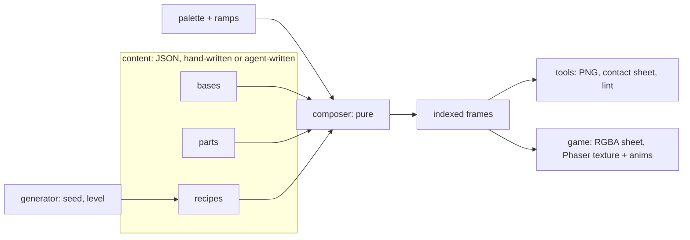

# Sprites: how pixel art is made, organised and used

Status: the sprite pipeline below is **planned**; its design is settled (section 9). The painted pictures of Keri (section 1, [art-direction.md](art-direction.md), d111) are **built** and are not part of that pipeline. The decisions are in `docs/decisions/art.md#d051`, the work is the feature ft_Y_11 (`docs/features/ft_Y_11-sprite-toolkit.md`), and its first big user is modular monsters (ft_Y_02, `docs/features/ft_Y_02-modular-monsters.md`). Read this before adding a picture to the game.

The goal: pixel art that stays original, consistent and cheap to grow, and that an agent can draw, check and fix without a human paint program. Monsters are built from a **base body plus parts** (eyes, legs, tails, wings ...) that are added as the monster's level rises, so a hundred monsters cost a few dozen small drawings.

## 1. Where we are today

- **The pixel kit** (`src/game/ui/pixel/`, decision d028): a 79-colour palette with shade ramps (`palette.ts`, `RAMPS`), bitmaps as palette indexes made from rows of letters (`bitmap.ts`: `fromAscii`, `blit`, `flipX`, `recolor`, `toRgba`), the font, icons and frames as code (`sprites.ts`, `frames.ts`), Kiur painted from one small model on the fine grid (`kiur/kiurModel.ts`, `kiur/kiurFrames.ts`; a tree pipit, d114), and textures made from raw RGBA (`PixelObjects.ts`; canvas textures were 3 times slower, see d028). A button centres its letters, not the whole text picture (whose empty tail rows would lift a label without tails), and `PixelButton.labelFit` says how far the letters reach past the two-pixel frame; `tests/e2e/button-fit.spec.ts` checks that no label on any screen does, and that no pixel-font text runs off the screen, at 1920x1080, 1920x960, 1536x864 at 125%, 1280x720 at 150%, 1366x768 and 1024x600 (the editor's bottom bar grew to 40 art pixels so the checker's two-line message fits). A row of choices of which one is chosen (the menu's Practice, Fight and Make) uses the `tab` look: the chosen tab is flat and dark with gold letters, so it reads as where you are, not as a key that lit up.
- **Painted pictures** (`src/game/ui/pixel/paint/`, decision d111): a background that needs depth and light (the warden's room, and in a simpler way the map of Keri, `keri/mapPicture.ts`) is not drawn pixel by pixel. It is a set of simple shapes in metres (flat pieces, boxes, cones, round blobs, each with a material: plaster, planks, bricks, cloth) that a ray caster looks at through a camera (`trace.ts`); a painter lights what it finds with a few lamps, soft shadows, dark outlines and a slightly wobbling lens (`painter.ts`); and the full-colour result is brought down to a palette with ordered dither (`reduce.ts`). Such a picture has its own palette (the game's colours plus more shades, at most 256) and is made when the game is built (`tools/vite-keri.ts`, the module `virtual:keri-pictures`), because painting takes seconds. Sprites laid into it are lit by the light at their place. To judge a change, paint the picture to a PNG file and look at it: `npm run art:render -- <room|map|knoll> [day|dawn|dusk|night] [file.png] [zoom]` (the file defaults to `test-logs/art/`, which git ignores). The whole manner, its rules and how to study references are in [art-direction.md](art-direction.md).
- **Framing a scene (d111):** never darken the corners or edges of a picture with a shadow or vignette laid over it. Close a corner with things placed there, as the painted adventure games do: near the viewer in a room (a beam or brace for a top corner; a wood pile, a stack of books, sheet music, a bundle of maps, a curtain, a kettle, a clothes stand below), on a map a scroll, a compass rose or a cloud. Such a prop is never a button and hides none (`keri/roomSet.test.ts` checks the room). This holds for every scene. Closing a corner is not a duty (the knoll's right side stays open as a sea view): a corner may stay open where the view is the point; only the laid-on shadow is forbidden.
- **A cloud is one stroke that rolls up into a head, never two alike** (d111): a fine point at its tail, a bent streamer that fattens, a solid round head with its curl as a soft line inside; maybe more curls on its back, and a fat cloud is a heap of them. No dark outline: pale on top, shaded underneath. Paint it with `keri/curlCloud.ts`, give every cloud of a picture its own spec, put the big fat ones behind the long thin ones and small flat ones low over the sea, and let every head lead where the wind blows. Never a coil with sky between its turns, an outlined lump, a thin string with a ball on it, or one shape twice.
- **One palette for Keri's outdoor scenes** (`src/game/ui/pixel/keri/keriPalette.ts`, d111): a pixel-art scene of the island paints in named runs of colours (grass, dry, far, shingle, stone, earth, ash, bush, near, stem, bloom, smoke, sky, cloud, sea, foam, ember), each dark to light: the colours written there are a run's named tones (`run`), and between them the palette puts colours until no step of lightness is over 8 L* (`fine`, the whole run; d111). Paint a small thing in a named tone and what shades off through the whole run. The file also holds the four hours (what an hour's sky, clouds and sea are, and the light it lays on the land). `scenePalette()` gives a scene the runs' places and its palette at an hour; a scene's own colours are added by name and lit like the rest. Never give an outdoor scene a private green or a private night: change the shared table, and look at every scene after. The room and the map have palettes of their own (d111).
- **Whole-number zoom and the fine grid (d110):** the art canvas is 640 x 360 fine pixels, zoomed 1x to 4x (`frameView` in `core/layout/frame.ts`), nearest-neighbour, so pixels stay square: 3x on the target laptop's 1920x1080 screen. Layouts, the font and the art drawn before d110 count in cells of 2 x 2 fine pixels (320 x 180 cells, 6x on the target laptop); new art is drawn on the fine grid with `PixelScene.fineImage`. The zoom counts physical screen pixels, not CSS pixels, so under Windows display scaling an art pixel is still a whole number of screen pixels.
- **The turn battle's art** (`battleArt.ts`): Kiur in three class outfits (48 x 48 on the fine grid, 24 x 24 cells: Kiur with a hat on his head, extras blitted on; d114), the four element icons and the ability icons (11 x 11, outline style A, each a different shape so none depends on colour), and `monsterAura`, a pure function that rings any monster picture with a light inner and a dark outer outline, flame spikes and a "!" (two pulse looks and a steady one for reduced motion). `?demo=battle-art` shows them all on one contact sheet.
- **The template character** (ft_1_24, `src/game/ui/pixel/actors/`, d142, d144): every person in a scene is one body, a puppet of a few shapes per layer (head and face, hair, headwear, top, bottom, boots, a held thing), posed by two-bone limbs and cast on MI2's own grid, blocks of 2 x 2 fine pixels; 72 x 104 fine pixels at size 1, feet at the anchor. No line round a figure (unlike the battle sprites' style A): five-tone ramps per material (`ramps.ts`), the shaded edge in the deepest tone, a contact shadow behind what is in front, and the scene's hour light through keriPalette's `lit`. A person is one option per key of `FEATURE_SET` (`features.ts`); a walker or visitor is `generateFeatures(seed)`; states idle, talk, listen, play (only with an instrument; anyone else idles) and walk are in `states.ts`; `figureFrames(features, state, { scale, hour })` and `templateActorNumbers` give the frames and the `ActorDef` numbers. A child (`age: child`, the student, d154) is the same template on `BODY_CHILD`, about three heads, with a student's face. Look at all of them with `npm run art:render -- figures [hour]`. The painter's notes: `projects/painter/notes/characters.md`.
- **One monster picture**, Wobble (content/monsters/wobble.json; all monsters are drawn from the monster files): a fixed 32 x 25 picture as letter rows with a legend of palette names, validated by src/core/battle/content.ts and turned into a bitmap by src/game/battle/monsters.ts.
- **What is missing:** a way to draw a picture once and use it in many colours, parts that attach to a body, animation frames as data, and a way to *look* at a picture outside the running game (an agent cannot judge a row of letters by reading it).

## 2. Engine: stay on Phaser

Phaser stays (d007). It does what pixel art needs (nearest-neighbour textures, whole-number zoom, sprite sheets and animations), it is code-first, which suits an agent, and Web MIDI is plain browser JavaScript next to it. The alternatives (Kaplay, Excalibur, PixiJS, Godot) were looked at again and none fixes a problem we have: the hard part of pixel art is the **art pipeline**, not the engine.

The design below keeps it that way: everything up to the finished picture is pure TypeScript with no engine in it. Phaser only receives RGBA bytes and frame rectangles at the very end. Changing engines would mean rewriting about one file of glue.

## 3. The pipeline



Each layer does one job, and only the last one knows Phaser:

| Layer | What it is | Where (planned unless it exists) |
|---|---|---|
| Palette and ramps | the fixed colours, grouped into shade ramps | `src/game/ui/pixel/palette.ts` (exists; grows ramps) |
| Indexed bitmap | width, height, palette indexes; index 0 is clear | `src/game/ui/pixel/bitmap.ts` today, moving to src/core/sprite/ (planned) |
| Slot bitmap | a drawing in colour *slots* (body dark, accent light ...) instead of colours | src/core/sprite/ (planned) |
| Base | a body drawing plus its sockets (where parts attach) | content/sprites/bases/ (planned) |
| Part | a drawing of one part, its pivot, layer, mirroring and frames | content/sprites/parts/ (planned) |
| Recipe | one monster's look: base, size, colours, parts | content/monsters/ (exists; the format is planned) |
| Generator | `(seed, level) -> recipe`, inside the level's budget | src/core/sprite/ (planned) |
| Composer | recipe + catalogue + animation + frame -> indexed bitmap | src/core/sprite/ (planned) |
| Game glue | indexed frames -> one RGBA sheet -> Phaser texture, frames and animations | src/game/battle/ (exists; the view is planned) |
| Tools | render a PNG, a contact sheet, lint, palette export, import | tools/sprite/ (planned) |

### 3.1 Palette and ramps

The palette stays one list in `palette.ts`, so the whole look changes in one place, but colours are grouped into **ramps** of three shades (dark, mid, light). The art style test added seven: purple, leaf (green, also the stage's ground), orange, red, pink and brown with three shades each, and skin with two (brown and skin are for people, paths and trees), so the palette had 38 colours, and the night scene of the campaign trail added 15 more (53); blue and gold were ramps already. Kiur's feathers added 16 (69, d114): umber and buff with four shades each, down and leg with three, and his outline and streak colours. The warm screens added 10 (79, ft_1_20, d118: warmer, comfier colours for the whole game): `night`, the three `panel` tones, `dim` and `lock` kept their names and places and became warm browns, and with them came the line cut round a panel (`groove`), a face under the pointer (`panelLit`) and the letters on wood (`honey`, `honeyDark`); the cold tones they had been stay as paints under names of their own, `dusk` in four shades (the battle stage's backdrop, the room's portrait) and `silver` in two (steel, a wig, steam), so no sprite and no painted picture changed with the screens. That is still small, which keeps the look consistent.

- Every ramp is checked by a test: the three shades get lighter in order, and the mid shade stands out from `ink` and from the battle stage's backdrop and ground: `art.test.ts` asks for a contrast of at least 3 against `ink` and an RGB distance of at least 60 from `dusk`, `duskLight`, `leaf` and `leafLight`, and from the wood of the screens (`night`, `panel`).
- **Colour pairs** (body ramp + accent ramp) that monsters may use are a list in content, so an ugly or hard-to-tell pair (for colour-blind players too) is removed by editing data. A test checks each pair's contrast.
- New colours are original and go into `docs/assets.md` with the kit's row.

### 3.2 Slots: draw once, use in any colour

A base or part is drawn in **slot letters**, not palette colours. The composer fills the slots from the recipe's ramps.

| Letter | Slot | Filled with |
|---|---|---|
| `.` | clear | nothing |
| `o` | outline | `ink` |
| `B` `b` `h` | body dark, mid, light | the recipe's body ramp |
| `A` `a` `i` | accent dark, mid, light | the recipe's accent ramp |
| `w` | eye white | `white` |
| `p` | pupil | `ink` |
| `m` | mouth inside | `red` |
| `t` | teeth, claws | `cream` |

The same wing is a purple bat wing on one monster and a green one on the next; a rare "shiny" colour pair costs no drawing at all. Fixed colours (`w`, `p`, `m`, `t`) keep faces readable on every body. A legend may still name a palette colour directly for one-off details.

Rule of thumb for drawing (and for the lint): light comes from the top left; use at most the three shades of a ramp plus outline; no lone single pixels of a different colour inside a flat area; outlines closed.

### 3.3 Bases and sockets

A **base** is a body: a slot drawing per size class (small, medium, large, as in ft_Y_02) plus **sockets**, the places parts attach. For each part kind a base gives a path (a list of points along its outline), and the composer spreads the parts evenly along it, so 2 legs and 8 legs both fit the same base:

```json
{
  "schemaVersion": 1,
  "id": "blob",
  "source": "original",
  "license": "MIT",
  "sizes": {
    "small": {
      "rows": ["....oooooooo....", "..oohhbbbbbboo..", "..."],
      "ground": 15,
      "sockets": {
        "legs":  { "path": [[3, 14], [12, 14]] },
        "eyes":  { "center": [8, 6] },
        "mouth": { "center": [8, 10] },
        "horns": { "path": [[4, 1], [11, 1]], "mirror": true },
        "wings": { "points": [[2, 6]], "mirror": true },
        "tail":  { "points": [[15, 11]] },
        "arms":  { "points": [[1, 9]], "mirror": true },
        "aura":  { "center": [8, 8] }
      },
      "overrides": { "legs": { "6": [[2, 14], [5, 15], [8, 15], [11, 15], [14, 14], [8, 13]] } }
    }
  }
}
```

- `mirror: true` sockets are given for the left half only; the composer mirrors them across the base's centre and flips the part, so pairs are always symmetric.
- `overrides` hand-places one count when even spreading looks wrong. Pixel art often needs that: the computed positions are the default, never a cage.
- **Eyes** use a fixed layout per count (1, 2, 3, 4, 6, 8) around `eyes.center`, from a small table, because eyes in a row along a curve read badly.
- `ground` is the row the feet stand on, so every monster stands on the battle stage's ground (stage row 56) whatever its size.

### 3.4 Parts

A **part** is one drawing (or a few frames) with a pivot, the point that lands on the socket:

```json
{
  "schemaVersion": 1,
  "id": "wings.bat",
  "kind": "wings",
  "style": "bat",
  "source": "original",
  "license": "MIT",
  "pivot": [7, 5],
  "layer": "back",
  "sizes": ["medium", "large"],
  "frames": {
    "idle": [["rows of frame 1"], ["rows of frame 2"]],
    "attack": [["rows"]]
  }
}
```

- **Layers** set the drawing order: `aura` < `back` (wings, tails, horns, back legs) < `body` < `front` (front legs, arms) < `face` (eyes, mouth). A kind has a default layer in a kinds table; a part may change it. With several legs, the pair nearest the viewer is `front` and the others `back`, shifted one pixel up so they read as further away.
- `sizes` says which bases it fits; a large base may use a bigger drawing of the same part (`legs.stubby` for small, `legs.stubby.large` for large) or reuse the smaller one.
- An animation a part does not have falls back to its `idle` frames, and a frame index wraps (`f mod frames`), so a part with one frame works in every animation.

### 3.5 Recipes

A **recipe** is a monster's whole look and is small enough to save, share and test:

```json
{
  "base": "blob",
  "size": "medium",
  "body": "purple",
  "accent": "gold",
  "parts": [
    { "kind": "eyes", "style": "round", "count": 3 },
    { "kind": "mouth", "style": "fangs" },
    { "kind": "wings", "style": "bat" },
    { "kind": "legs", "style": "stubby", "count": 4 }
  ]
}
```

In a monster file (content/monsters/<id>.json) the recipe replaces `picture` when the monster format goes to version 2. A fixed picture stays allowed, so hand-drawn bosses are possible. **Wobble keeps its drawn picture** (decided): it is the student's first monster and should keep its look, its screenshot baselines stay as they are, and it proves the fixed-picture path still works. The blob base is drawn new, in Wobble's spirit. Version 1 files migrate by moving `picture` under `look`, with a test and a fixture, as every format here does. Recipes name parts by id, so a renamed part is a content error caught by a test, never a broken image in the game.

### 3.6 Generator

`generateRecipe(seed, level, catalogue, rules)` (pure, uses `src/core/random.ts`): same seed and level, same monster, on every machine. The numbers (budget `2 x level`, part costs, size by level, the allowed colour pairs, how likely each kind is) are content (a planned `generator.json` in the monsters folder), not code, so tuning needs no programmer. Every part in the catalogue can be used: art has no approval gate, so a part that should not appear yet is left out of the catalogue or of the generator's weights. A defeated monster can be saved as `{seed, level}` (tiny) or as its recipe (survives a generator change); saving the recipe is safer.

### 3.7 Composer

`composeFrame(recipe, catalogue, animation, frame) -> Bitmap` (pure):

1. Make a canvas for the size class (small 32 x 28, medium 48 x 40, large 64 x 48 art pixels; never scaled up), put the base with its `ground` on the canvas floor, centred.
2. Resolve every part to socket positions (path spreading, mirror, overrides, eye tables).
3. Draw by layer, each part's slot drawing filled with the recipe's ramps; mirrored parts are flipped.
4. Apply the animation's offsets for this frame (section 3.8).
5. Outline pass: a one-pixel `ink` outline around the whole silhouette, which also hides seams where a part meets the body. Every sprite has this black outline (style A); the sprite lint checks it.

The result is an ordinary indexed bitmap, so everything the kit already does (`toRgba`, golden tests) works on it.

### 3.8 Animation

Animations are short loops at a low frame rate (pixel art reads best at 4 to 8 frames per second): `idle` (4 frames), `attack` (3), `hit` (2), `win` (4). An animation is a small timeline in content: per frame, which frame each part shows and a whole-pixel offset per layer (the body bobs one pixel, wings go up while the body goes down). Shape changes are drawn into frames; colour and motion effects are done by Phaser at play time (a white flash on a hit, fading out on a defeat, a shake), not drawn as frames. That keeps the number of frames small.

### 3.9 In the game

When a monster enters a battle its frames are composed once, packed side by side into **one** RGBA sheet, uploaded as **one** texture (raw RGBA, like the kit), and given Phaser frames and animations. A monster is one `Sprite` at the scene's zoom. Composing 15 frames of 64 x 48 pixels takes well under a millisecond, so caching beyond "once per battle" is not needed; the texture key is a hash of the recipe so two battles with the same monster share it.

## 4. How an agent draws a sprite (the look-and-fix loop)

An agent cannot paint, but a 32 x 32 sprite is a grid of letters, which an agent can write, and an agent **can look at a PNG**. So the loop is:

1. Read the palette, the slot table (section 3.2) and two or three existing parts of the same kind.
2. Write the rows (draw the left half of a symmetric thing and mirror it).
3. Run the sprite lint: row widths, legend letters, pivot inside the drawing, symmetry where claimed, size limits, closed outline, no stray pixels.
4. Render it to a PNG, scaled 8x, on a checkerboard, and also composed onto two or three bases in two colour pairs and at 1x real size.
5. Look at the PNG (Claude Code's Read tool shows images), compare against the checklist: does it read at 1x, is the silhouette clear, light from the top left, no banding, fits the family of existing parts. Fix the rows. Usually 2 to 4 rounds.
6. Show the maintainer the render and the contact sheet. Art has **no approval gate**: unlike pieces, a part is usable once it passes the lint, and the maintainer's look is a review, not a status in the file.

The **contact sheet** is the most useful view: every level from 0 to 12 down the side, eight seeds across, at 2x. Generator bugs (a leg floating in the air, a part cut off, two colour pairs that clash) show up as patterns on one sheet and never in a single render.

Tools (all planned, in tools/sprite/, written in TypeScript and run with tsx like the piece tools; none exists yet):

| Script (planned) | Does |
|---|---|
| sprite:render | render a part, base, recipe or monster (and an animation as a strip) to an upscaled PNG in `build/sprites/` (gitignored) |
| sprite:sheet | contact sheet: levels x seeds, or every style of a kind on every base |
| sprite:lint | check every base, part and recipe in content; errors fail CI, warnings are for review |
| sprite:palette | write the palette as a `.gpl` file for Aseprite, LibreSprite or Piskel |
| sprite:import | read an indexed PNG drawn in one of those editors back into slot rows (exact palette colours only) |

The PNG writer is about fifty lines on Node's own `zlib` (one IDAT chunk, CRC32): no Python, no Pillow, no image library. The browser side gets a sprite page in the preview tool (a planned `?demo=sprites`, like the piece preview): parts and bases browser, a recipe editor with live composing, seed and level sliders, and animations playing at real zoom on the battle strip.

A **project skill** (planned, `.claude/skills/pixel-sprite/SKILL.md`, written once the tools exist so it never names a command that is not there) holds the steps above and the drawing checklist, so "draw a horned-tail part" follows the same loop every time.

## 5. Where things live

```text
content/
  monsters/
    wobble.json              a monster: stats + a fixed picture (today) or a recipe (version 2)
    generator.json           budget, part costs, sizes by level, colour pairs   (planned)
  sprites/                                                                      (planned)
    kinds.json               part kinds: default layer, socket, mirror, max count
    animations.json          animation timelines
    bases/blob.json          a base in every size, with sockets
    parts/eyes/round.json    one file per part style, frames inside
    parts/legs/stubby.json
src/core/sprite/             bitmap ops, slots, sockets, composer, generator, recipe schemas (planned; pure, 90% coverage)
src/game/ui/pixel/           palette RGB, textures from RGBA, the UI kit (exists)
src/game/battle/             monster view: compose, pack, texture, animations (exists; the view is planned)
tools/sprite/                render, sheet, lint, palette, import, PNG writer (planned)
build/sprites/               rendered PNGs and sheets for review (gitignored)
```

The UI kit (font, frames, icons, Kiur) stays as code in `src/game/ui/pixel/`: it is small, typed and tested where it is. Characters and monsters move to content, because the project rule is that adding content needs no engine code.

## 6. Tests

- **Golden images:** a few recipes, composed, hashed; a change to the composer or a part shows as a changed hash and a PNG to look at.
- **Properties** (fast-check, as the generators already do): the same seed and level give the same recipe; the generator never spends over budget or over a kind's count; every level 0 to 12 makes a valid monster for a few hundred seeds; nothing is drawn on the canvas edge (nothing cut off); mirrored pairs are symmetric; every part fits the sizes it claims; every colour pair passes the contrast check.
- **Content lint in CI:** every base, part and recipe parses, uses known slots and known part ids.
- **Screenshot:** the battle screenshot test covers one composed monster at 1366x768.
- **Human:** do the monsters appeal to a young student, and are the high-level ones fun-scary rather than frightening (a playtest).

## 7. Extensions (later, each needs its own feature file before building)

- **Visible damage:** parts fall off as HP drops; the composer takes a list of parts to leave out.
- **Bestiary:** the monsters a player has beaten, saved as recipes per player (a save version step).
- **Names from parts** through string keys ("Three-eyed Flapblob").
- **More bases:** a slug, a ghost drop, a box golem; each brings its own sockets, and every part works on it.
- **Procedural bases:** a body drawn from a few numbers (a squashed circle with a wobble), shaded and outlined by code; sockets come from its edge, so the base has its own arcs for free. Hand-drawn bases look better; generated ones give endless variety. A mix is likely.
- **Auto-shading:** a part drawn flat in one slot gets its dark and light shades from its shape (light top left, dark bottom right); halves the drawing work for simple parts.
- ~~**Monster maker**~~ (the student builds a monster from parts unlocked by beating monsters): **not wanted**. Kept here so it is not proposed again.
- **Kiur's outfits:** hats and scarves are parts on Kiur's sockets; the same composer.
- **Monsters by musical style:** when classes and styles come (ft_Y_03), a style can prefer some parts (staccato: spikes; legato: long tails).
- **Animated GIF export** of a monster for playtest notes.
- **Reduced motion:** a setting that stops idle animations (accessibility, docs/futureproofing.md).
- **Tiles and maps** for the RPG world (ft_Y_03): the same palette and lint, with Tiled for map layout; a separate pipeline, not part of this one.

## 8. Considered and not chosen

- **PNG files as the source of art.** Binary, not diffable, an agent cannot edit them, and colour drift creeps in. PNGs are build output; text rows are the source. The import tool covers the case of a human who prefers a paint program.
- **Python and Pillow for the tools.** A second toolchain on a Windows machine for one PNG writer the size of a function.
- **Aseprite (and community MCP servers for it).** Good editor, paid, and the MCP servers are unvetted. Not needed by the pipeline; the palette export and import let the maintainer use it (or the free LibreSprite, Piskel, Pixelorama) if wanted.
- **AI image generators.** Their pixels rarely sit on the grid, the colours do not match the palette, and the licence of the output is unclear, which sits badly with the licence rules. **Out for now**; may be looked at again later.
- **Asset packs** (Kenney, OpenGameArt). Left out under the original-art rule in d028; **now welcome** (d084): import a piece to text rows, map it to the palette, list it in `docs/assets.md`. The packs that fit our size: the `use-free-art-packs` skill (`.claude/skills/use-free-art-packs/SKILL.md`).
- **Many game objects per monster** (one Phaser image per part). ft_0_13 found many small objects slow; one texture per monster is cheaper and easier to test.

## 9. Settled

1. **Approval gate for art: no.** Bases and parts carry no `status`; a part is usable once it passes the lint.
2. **Composer in core:** in the planned src/core/sprite/ module, pure and coverage-gated, as proposed.
3. **Sockets as paths with hand overrides**, as proposed.
4. **Wobble keeps its drawn picture** (left to the agent; reasons in section 3.5).
5. **Monster maker: not needed.**
6. **AI image generators: out for now**, to be decided later.
